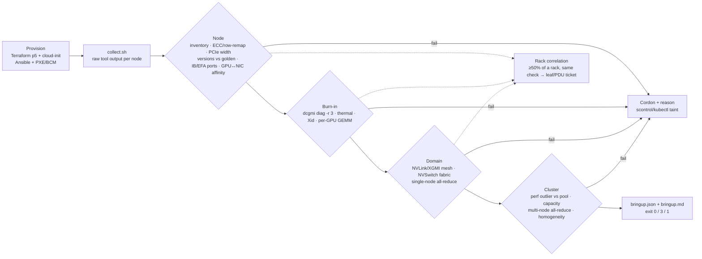

# gpu-cluster-bringup

> Part of [inference-qa-lab](../README.md). Run every command from `gpu-cluster-bringup/`. CI: [`gpu-cluster-bringup.yml`](../.github/workflows/gpu-cluster-bringup.yml), which runs when this folder changes.

Staged acceptance for multi-node GPU clusters, for both NVIDIA and AMD nodes. It takes the raw output of the tools you'd run on a freshly provisioned node (`nvidia-smi -q -x`, `nvidia-smi topo -m`, `dcgmi diag -r 3`, `ibstat`, `fi_info -p efa`, `lspci -vv`, `rocm-smi --json`, `all_reduce_perf`) and returns a machine-readable verdict per node and per cluster. Nodes move through **node → burn-in → NVLink/rack domain → cluster** gates. A node that fails any gate is **cordoned with the stage and the reason**, never dropped silently. The cluster ends as **ACCEPTED / ACCEPTED_DEGRADED / REJECTED**, with exit codes that CI and Ansible can gate on. Provisioning examples cover cloud (Terraform for AWS p5 + cloud-init) and on-prem (Ansible inventory + PXE/BCM notes), and both run the gates as their post-provisioning hook.



## What's covered

| Stage | Property | Test |
|---|---|---|
| Parsers | `nvidia-smi -q -x` in Hopper tags (sram/dram ECC, `clocks_event_reasons`, `gpu_power_readings`) and legacy tags (single/double-bit ECC, retired pages, `clocks_throttle_reasons`); `N/A` stays `None`, never 0 | `test_hopper_xml_fields_and_idle_gen`, `test_legacy_xml_tags_ecc_retirement_and_throttle` |
| Parsers | `dcgmi diag -r 3` table: continuation rows, word-wrapped warnings, Skip ≠ Fail | `test_dcgm_failure_with_wrapped_warning_and_skips` |
| Parsers | `topo -m` with the NIC legend, `ibstat` with IB and Ethernet mixed, `fi_info` EFA, `lspci -vv` incl. `rev ff`, `rocm-smi --json` key drift, nccl-tests `#wrong` | `tests/unit/test_parsers.py` |
| Node | A GPU still on the PCIe bus but gone from the driver is reported as fallen off the bus | `gpu_missing` e2e case |
| Node | Idle gen1 is **not** a down-train; x8 width is; a slot capped at gen4 is | `test_idle_gen1_is_not_a_downtrain`, `test_slot_capped_at_gen4_fails` |
| Node | GPU↔NIC affinity is matched by topology rather than index, so renumbering after a lost GPU doesn't cause false failures | `test_affinity_matching_survives_gpu_renumbering` |
| Node | The same gates run on AMD (rocm-smi + lspci) and on AWS EFA | `test_amd_nodes_run_the_same_gates`, `test_amd_pcie_width_comes_from_lspci`, `test_efa_fabric_counts_devices` |
| All | Each injected defect is caught **at its stage, by its check alone** (or with a declared downstream consequence) | `test_each_defect_caught_at_the_right_stage_for_the_right_reason` (12 cases) |
| All | Cordoned nodes never enter later stages; no node is silently missing; missing evidence fails closed | `test_cordoned_nodes_do_not_enter_later_stages`, `test_missing_evidence_fails_closed` |
| Rack | 5/8 nodes losing the same rail → one leaf-switch finding | `test_leaf_switch_failure_reported_as_one_rack_finding` |
| Cluster | A node that clears every floor but is 8% slower than the pool gets cordoned; a capacity shortfall or slow fabric gives REJECTED | `straggler` e2e case, `test_capacity_shortfall_rejects_the_cluster`, `test_slow_multinode_allreduce_rejects` |
| Provisioning | cloud-init renders to valid YAML that runs the hook; on-prem pins == golden manifest | `tests/unit/test_provisioning.py` |

## Failure design

The simulated fleet (32 HGX H100 + 4 MI300X, 5 racks) injects one of each defect below. Each one is rendered into the real tool's output format, the way it would show up on hardware.

| Defect | How it shows up | Caught at | Check |
|---|---|---|---|
| One GPU missing | nvidia-smi lists 7; lspci still has it at `rev ff` | node | `gpu_inventory` |
| Uncorrectable ECC (NVIDIA and AMD) | `dram_uncorrectable=2`, row remap pending / RAS UMC count | node | `gpu_memory_health` |
| PCIe x16 → x8 | `current_link_width 8x`, lspci `(downgraded)` | node | `pcie_link` |
| Driver drift on one node | `550.90.07` vs golden `550.127.08` | node | `software_versions` |
| IB port down | `State: Down / Polling` | node | `fabric_ports` |
| Wrong GPU↔NIC NUMA affinity | GPU6↔mlx5_6 `SYS` in `topo -m` | node | `gpu_nic_affinity` |
| Weak power delivery | dcgmi `Targeted Power` Fail on GPU 5 | burn-in | `dcgm_diag` |
| Cooling fault | 92 °C, 340 s `hw_thermal_slowdown` | burn-in | `thermal` |
| GPU falls off the bus under load (passes idle checks) | `NVRM: Xid ... 79` in dmesg | burn-in | `xid_events` |
| 6 NVLinks dead on one GPU | `NV12` to all peers, single-node busbw 292 GB/s | domain | `nvlink_topology` (+ `allreduce_single_node`) |
| Straggler, 8% slow | above every floor, below the pool median | cluster | `performance_outlier` |

Sample outputs: [`docs/sample-reports/defects.md`](docs/sample-reports/defects.md) (ACCEPTED_DEGRADED, 24/36 accepted, still above the 20-node pool minimum) and [`leaf-down.md`](docs/sample-reports/leaf-down.md). The reasoning behind each threshold is in [`docs/THRESHOLDS.md`](docs/THRESHOLDS.md). The day-0 to day-2 checklist is in [`docs/RUNBOOK.md`](docs/RUNBOOK.md).

## Run it

```bash
make venv && make test                    # 68 tests, ~1s
python -m bringup gen-fleet --scenario defects --out fleet/defects     # also: healthy, leaf-down
python -m bringup run --fleet fleet/defects --manifest manifests/golden.json --out reports/defects
# exit 0 ACCEPTED · 3 ACCEPTED_DEGRADED · 1 REJECTED · 2 usage error
python -m bringup node --captures /var/lib/bringup/captures --manifest manifests/golden.json   # per-node hook
```

On a real node, run `sudo scripts/collect.sh <out> <rack> <node_type>` to produce the same capture layout.

## CI

[`ci.yml`](../.github/workflows/gpu-cluster-bringup.yml) has three jobs. One runs the tests. One runs sample bring-ups of the healthy, leaf-down and defects fleets, asserts their exit codes and that the cordon list equals the injected set, then posts the report to the job summary. The third runs `terraform fmt`/`validate` on the p5 module, `ansible-playbook --syntax-check` on the on-prem plays, and `shellcheck` on `collect.sh`.

## Layout

```
bringup/parsers/   nvidia_smi · dcgm · topo · fabric (ibstat, fi_info) · lspci · rocm_smi · nccl
bringup/           model (vendor-neutral facts) · collect · gates · pipeline · allreduce (runner stub) · report · fleetgen · cli
manifests/         golden.json (H100 + MI300X on-prem) · aws-p5.json (EFA)
provision/         aws-p5/ Terraform + cloud-init hook · onprem/ Ansible inventory, site.yml, acceptance.yml, PXE_BCM.md
scripts/collect.sh evidence capture on a real node
docs/              RUNBOOK.md · THRESHOLDS.md · sample-reports/
```

## Where this stops

- **No GPUs were involved.** The parser fixtures are written by hand in the tools' real formats, modelled on documented and commonly seen output. They were not captured from hardware, and tag or key names can differ between driver and ROCm releases. Run `collect.sh` on one known-good node per node type and add its output as a fixture before trusting the parsers on that fleet.
- **Burn-in is simulated.** `burnin.json` is a summary schema this repo defines. `collect.sh` keeps the soak tool's raw log, but turning that log into `burnin.json` is site-specific and isn't included. On AMD, RVS/AGFHC output is not parsed, so `dcgm_diag` is an explicit SKIP there.
- **The all-reduce steps are a stub interface.** `NcclTestsRunner` builds the real `mpirun … all_reduce_perf` command line but has never run here. CI uses `FixtureRunner`, which returns captured output and doesn't vary with how many nodes were accepted.
- **AMD GPU↔NIC affinity** comes from lspci NUMA nodes, so it can't see PCIe-switch locality the way `topo -m` can.
- **The provisioning code has never been applied.** The Terraform passes `validate` only; it has not been `apply`'d. The Ansible plays pass `--syntax-check` only and have not run against hosts.
- **Thresholds are placeholders** of the right magnitude, not vendor specs. Re-baseline them on your own known-good nodes (`docs/THRESHOLDS.md`).
