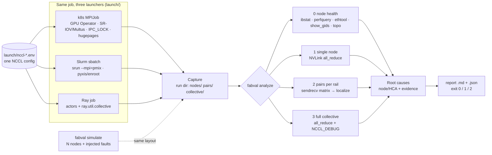

# gpu-fabric-validation

> Part of [inference-qa-lab](../README.md). Run every command from `gpu-fabric-validation/`. CI: [`gpu-fabric-validation.yml`](../.github/workflows/gpu-fabric-validation.yml), which runs when this folder changes.

A validation harness for the GPU cluster fabric: the NVLink, InfiniBand/RoCE and NCCL layer that every distributed inference or training job relies on. The same NCCL job is launched three ways, as a Kubernetes MPIJob, a Slurm sbatch with PMIx and pyxis, and a Ray job over GPU actors. All three share one NCCL configuration. The harness reads the results the real tools print (`nccl-tests`, `NCCL_DEBUG=INFO`, `ibstat`, `perfquery`, `ethtool -S`, `show_gids`, `nvidia-smi topo -m`), gates them against a topology-aware model of expected bandwidth, and localizes a degradation to the **node and HCA** that caused it, with the host-side evidence that explains why.

There are no GPUs here. A simulator writes the same files a real capture produces, for N nodes with faults injected. The analyzer never imports the simulator. It reads only text files in the real formats, the same way it would read them from a real cluster.



## What's covered

| Area | Property | Test |
|---|---|---|
| nccl-tests parser | all_reduce / all_gather / alltoall / sendrecv: size, time, algbw, busbw, `#wrong`, avg bus bandwidth, OOB line | `test_nccl_tests.py` |
| nccl-tests parser | Legacy 12-column output, `-c 0` (`#wrong` = N/A), truncated runs, inline NCCL failure lines | `test_legacy_12_column_format`, `test_validation_off_reads_na`, `test_truncated_run_is_incomplete` |
| nccl-tests parser | busbw = algbw × the collective's factor and algbw = size/time, so a wrong collective or rank count can't produce a plausible number | `test_busbw_mismatch_flagged` |
| NCCL_DEBUG parser | Transport `NET/IB` vs `NET/Socket`, GDR per HCA (`/GDRDMA`), ring and tree channels, `NCCL_*` env echoes, WARN lines | `test_nccl_log.py` |
| Fabric health | `ibstat`/`ibstatus` state, phys state, rate, link layer; `perfquery` error counters; `ethtool -S` drops with PFC/ECN attribution; `show_gids` index; `nvidia-smi topo -m` GPU↔NIC path | `test_fabric.py` |
| Expected bandwidth | NVLink-bound intra-node, `min(NVLink, NICs × NIC × eff)` inter-node ring/tree, one-NIC p2p, alltoall remote share | `test_model.py` |
| Localization | Greedy endpoint cover over a per-rail pair matrix: port vs whole node vs a single link | `test_localize.py` |
| End to end | Each fault is detected **and** localized to the correct node/HCA with the correct cause, on both IB and RoCE | `test_each_fault_detected_and_localized` |
| End to end | Five simultaneous faults on 8 nodes are each localized, and nothing extra is blamed | `test_all_faults_at_once_on_eight_nodes` |
| End to end | No false positives across seeds and node types | `test_healthy_cluster_passes_with_no_findings` |
| Launchers | ConfigMap == env file; MPIJob has GPUs, RDMA resources, hugepages req == limit, `IPC_LOCK`, `/dev/shm`, one worker per node, all NCCL vars forwarded with `mpirun -x`; RayCluster workers match the MPI workers; sbatch uses PMIx, pyxis and the shared env | `test_launchers.py` |
| Launchers | The Ray job's rows parse as nccl-tests output, so the same gates apply | `test_ray_job_output_parses_as_nccl_tests` |
| CI | yamllint, kubeconform (core + MPIJob + NetworkAttachmentDefinition + RayCluster CRD schemas), shellcheck | `.github/workflows/gpu-fabric-validation.yml` |

## Failure design

The faults the simulator injects, the signature each one leaves, and the reasoning the analyzer uses to name it:

| Fault | Where it shows | Gate that catches it | Diagnosis evidence |
|---|---|---|---|
| HCA down-trained to 200G | Every pair on that rail at ~50%; the full all_reduce at ~50% because the slowest channel paces every rank | pair bandwidth (85% of expected) | `ibstat` Rate 200; `perfquery` SymbolError / LinkDowned / LinkErrorRecovery (IB) or `rx_symbol_err_phy` (RoCE) |
| RoCE port without PFC/ECN | Small-message latency 5-9× on that rail, while bandwidth stays at ~92% | **latency only** (pair median ≤ 64 KiB vs budget). The bandwidth gate passes it | `ethtool -S`: `rx_discards_phy` high, zero `rx_prio3_pause`/`tx_prio3_pause`, zero `rx_ecn_mark` |
| NIC on the wrong NUMA node | That rail at ~60% | pair bandwidth | `nvidia-smi topo -m` GPU*n*↔NIC*n* = SYS; NCCL log `GPU Direct RDMA Disabled` and `via NET/IB/n` without `/GDRDMA` |
| GID index mismatch on one node | Every rail of that node collapses; the job crawls at socket speed | pair bandwidth + latency, collapsed to node level | NCCL log `NET/IB : No device found` → `Using network Socket`; `show_gids` index 3 is not RoCEv2 IPv4 on that node (the IPv4 GID moved to 5) |
| Silent data corruption on one node | `#wrong > 0` in the full all_reduce, which can't say where | single-node stage `#wrong` | the per-node NVLink all_reduce names the node |
| Missing or truncated output | – | coverage | verdict INCONCLUSIVE (exit 2), never PASS |

Sample output for all five at once: [`docs/sample-reports/roce-8node-5faults.md`](docs/sample-reports/roce-8node-5faults.md).

## Run it

```bash
python3 -m venv .venv && .venv/bin/pip install -r requirements.txt
.venv/bin/python -m pytest                       # 66 tests, ~1s
.venv/bin/python -m fabval simulate --nodes 8 --fault downtrain:node-03:2 --fault pfc:node-05:4 \
    --fault numa:node-02:6 --fault gid:node-07 --fault corrupt:node-04 --out runs/demo
.venv/bin/python -m fabval analyze runs/demo --md reports/fabric.md --json reports/fabric.json   # exit 1
.venv/bin/python -m fabval expected --node-type h100-sxm-8x-ndr400-ib --collective all_reduce --nodes 4
.venv/bin/python -m fabval parse nccl-log tests/fixtures/nccl_logs/roce_gdr_off_and_socket.log
```

`analyze` exits 0 for PASS, 1 for FAIL and 2 for INCONCLUSIVE, so a pipeline stage can gate on it directly.

On a real cluster, the capture follows the runbook ([`docs/RUNBOOK.md`](docs/RUNBOOK.md)): `scripts/collect_node.sh` on every node, then `launch/slurm/pairwise.sh`, then the full job from any launcher, then `fabval analyze` on the run directory.

## Layout

```
fabval/            parsers (nccl_tests, nccl_log, fabric), model + topologies.json, localize,
                   analyze (stages + correlation), report, sim, cli; thresholds.json
launch/            nccl-roce.env / nccl-ib.env (single NCCL config), image/Dockerfile
  k8s/             MPIJob (RoCE + IB), SR-IOV NetworkAttachmentDefinitions, ConfigMaps, namespace
  slurm/           nccl_tests.sbatch (pmix + pyxis), pairwise.sh (per-rail pair matrix)
  ray/             raycluster.yaml (KubeRay), nccl_allreduce_job.py, submit.sh
scripts/           collect_node.sh (stage 0 + 1 capture), make_fixtures.py
tests/             unit/ · e2e/ · fixtures/ (nccl-tests, NCCL logs, ibstat/perfquery, ethtool/show_gids, topo)
docs/              RUNBOOK.md · NCCL_ENV.md · sample-reports/
```

## Where this stops

- **No real hardware ran this.** Every nccl-tests table, NCCL log and counter file in a test comes from the simulator or a hand-written fixture in the real tools' formats. The parsers are only as good as those formats, and a new NCCL or nccl-tests release can move a line. Run `fabval parse` on a real capture before trusting a gate.
- **The expected-bandwidth efficiencies are assumptions** (`fabval/topologies.json`), in line with publicly reported H100/A100 nccl-tests numbers. They need calibrating against a known-good node of your own fleet. NVLS/SHARP, multi-NVLink-domain (MNNVL) systems and PXN routing aren't modelled.
- **The fault signatures are simplified.** The simulator keeps a socket fallback confined to the bad node. On a real fabric, a GID mismatch is as likely to show up as IB completion errors (`error 12`) or a hang. The `show_gids` check catches it before NCCL runs either way. PFC/ECN misconfiguration is inferred from host counters only. Switch-side counters (buffer occupancy, CNPs) aren't read.
- **The manifests are validated against schemas, not run.** kubeconform checks them against the core, MPIJob, NetworkAttachmentDefinition and KubeRay RayCluster schemas, but no cluster schedules them here. The Slurm scripts pass shellcheck and nothing more. The Ray job's GPU path (`make_rank_class`, `main`) has never executed. Only its pure helpers are tested.
- Pairwise localization needs ≥ 3 nodes. With 2 nodes, every failure is "this link", and the host-side evidence has to do the rest.
