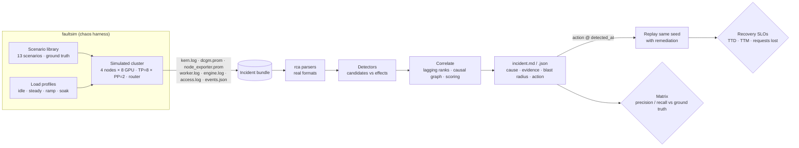

# gpu-fault-rca

> Part of [inference-qa-lab](../README.md). Run every command from `gpu-fault-rca/`. CI: [`gpu-fault-rca.yml`](../.github/workflows/gpu-fault-rca.yml), which runs when this folder changes.

Fault injection and cross-layer root-cause analysis for a multi-node GPU inference deployment. A chaos harness injects hardware, driver, runtime and serving faults into a simulated 4-node × 8-GPU cluster. The cluster emits telemetry in the **real formats** an on-call engineer would pull: kernel `NVRM: Xid` lines, dcgm-exporter metrics, PyTorch NCCL watchdog logs, vLLM-style engine logs, NGINX access logs, and `kubectl get events -o json`. An RCA engine reads only those files. It names the root cause, the layer, the node/GPU/rank, the evidence lines it used, the blast radius and the action. A replay then proves the action actually recovers the service within its SLOs.

The hard part is the red herrings. When GPU 3 on `gpu-node-1` falls off the bus, 15 *healthy* ranks across two nodes log NCCL watchdog timeouts, Kubernetes reports crash loops on both nodes, and both replicas breach the latency SLO. The one GPU at fault logs nothing at all. The engine blames that GPU.



## The deployment under test

Two model replicas run behind a weighted round-robin router with passive ejection (nginx `max_fails=1 fail_timeout=10s`, no POST retries). Each replica is TP=8 inside a node (NVLink all-reduce) and PP=2 across a node pair (NCCL send/recv over InfiniBand): `replica-a` = `gpu-node-0` + `gpu-node-1` (ranks 0–15), `replica-b` = `gpu-node-2` + `gpu-node-3`. The simulator runs in 1 s steps and models request latency with queueing, hung collectives until the 60 s NCCL watchdog fires, crash/restart/CrashLoopBackOff, GPU memory, temperature, clocks, ECC and NVLink counters, host CPU pressure, and IB port counters.

## What's covered

| Fault (scenario) | What the telemetry shows | What the RCA must get right | Test |
|---|---|---|---|
| Node hard power-off (`node_power_loss`) | Every source on gpu-node-3 stops mid-stream. Peers time out. NodeNotReady arrives 40 s later | Blame the silent node, not gpu-node-2, which reported the timeouts | `test_timeouts_on_healthy_ranks_blame_the_silent_node` |
| GPU fallen off the bus (`gpu_fallen_off_bus`) | Xid 79, the GPU drops out of DCGM, 15 ranks log NCCL timeouts, restarts find 7 GPUs | gpu-node-1 GPU 3, rank 11, with 16-rank blast radius | `test_xid79_rank_and_blast_radius` |
| Uncorrectable ECC (`ecc_uncorrectable`) | Xid 94 + Xid 63, DBE +1, remap pending, recurs after restart | Hardware, RESET_GPU, not "restart the worker" | `test_rca_names_injected_root_cause` |
| NVLink degradation (`nvlink_degraded`) | CRC flit rate scales with link load. Xid 74 once it's bad. TP slowdown | Found under a load ramp, silent at idle | `test_stress_only_faults_are_latent_at_idle` |
| IB link degradation (`ib_link_degraded`) | Symbol errors on gpu-node-1, but the NET/IB warnings are logged by gpu-node-0 | Blame the node with the port errors, which the peer's warnings also name | `test_timeouts_on_healthy_ranks_blame_the_silent_node` |
| Partial driver upgrade (`driver_partial_upgrade`) | `NVRM: API mismatch`, dcgm-exporter dies, `Error 803`, CrashLoopBackOff, peer NCCL timeouts | Driver layer on gpu-node-2. ROLLBACK_DRIVER | `test_rca_names_injected_root_cause` |
| Thermal throttling (`thermal_throttle`) | HW thermal slowdown bit 0x40, 900 MHz clocks, the TP group runs at the straggler's speed | One GPU on gpu-node-3. Silent at idle | `test_stress_only_faults_are_latent_at_idle` |
| Worker memory leak (`worker_memory_leak`) | FB-used climbs while the KV pool is preallocated, then CUDA OOM | Name the leak (and the GPU) **before** the OOM line | `test_memory_leak_detected_before_oom` |
| Noisy neighbour (`noisy_neighbour_cpu`) | Batch pod scheduled, PSI cpu 85 %, GPUs *idle* while p99 triples | Host layer, not GPU | `test_rca_names_injected_root_cause` |
| Bad engine build (`bad_engine_build`) | Image roll, then Xid 13 + 31 on six GPUs across two nodes, illegal memory access | One software root cause (rollback), **not** six RMAs | `test_bad_build_is_software_not_six_rmas` |
| Combined faults (`combo_*`) | Two independent faults, one per replica, plus failover overload | Both root causes, no third | `test_rca_names_injected_root_cause` |
| Slow leak (`soak_slow_leak`) | 0.6 MiB/request | 10-min run: precursor only. 50-min soak: OOM, root cause | `test_short_run_only_sees_slow_leak_as_precursor`, `test_soak_exposes_slow_leak` |
| Pure noise (`no_fault`) | Correctable SBEs, a stray profiler Xid 31, a 5 s latency blip | **No** root cause | `test_no_fault_raises_no_root_cause` |

The harness also checks itself: the analyzer imports nothing from the simulator (`test_rca_never_imports_the_simulator`), deleting `ground_truth.json` changes nothing (`test_ground_truth_is_never_read`), bundles are byte-deterministic per seed, and every parser is tested against hand-written fixtures in the upstream formats. Those fixtures include variants the simulator never emits: raw `dmesg` uptime stamps, pre-525 Xid formatting, Prometheus lines without timestamps, `+0100` NGINX offsets, ns-precision PyTorch stamps, and `eventTime`-only k8s events.

## RCA results

From `chaos matrix` (seeds 1–3; CI adds the run number as a fourth seed):

**Precision 1.000 · Recall 1.000** (TP 45, FP 0, FN 0) at confidence ≥ 0.7, over 13 scenarios plus idle-load runs of the two stress-only faults. The lowest passing confidences are thermal (0.72, DCGM is its only source) and NVLink / IB / leak (0.75). These are the ones to watch if a detector changes.

### How the engine decides

| Step | Technique | Why |
|---|---|---|
| Symptoms | 10 s windows per replica from the router log: p99 > 3 s for 2+ windows, or ≥ 3 5xx and > 1 % | Start from user impact. A signal that explains none is a precursor, not a page |
| Candidates vs effects | Xid / DCGM / PSI / IB / leak-trend / driver-mismatch / deploy signals open **candidates**. NCCL timeouts, OOM, crashes, NodeNotReady and BackOff are only ever **effects** | A rank that *reports* a timeout is waiting on someone else |
| Lagging ranks | In the first timeout wave, the ranks that did **not** report are the suspects | This is how the dead GPU, which logs nothing, gets found |
| Causal graph | Each effect and symptom is walked to a candidate that can cause it, in the same replica, with onset ≤ effect + 30 s skew. Ties go to stronger, then deeper layers | hardware → driver → runtime → serving → orchestration |
| Failover | Symptoms on the *healthy* replica after the other lost capacity are attributed to the original fault | Otherwise the survivor's overload looks like a second incident |
| Spread rule | Xid 13/31 on ≥ 3 GPUs across ≥ 2 nodes within 120 s, after an engine image roll, is a bad build | App-attributable Xids that spread are software |
| Confidence | Base per cause + 0.1 per independent source (kern, dcgm, node_exporter, nccl, engine, k8s) + 0.1 if it explains impact | Below 0.7 is reported as low-confidence, never dropped |

A sample report is in [`docs/sample-reports/gpu_fallen_off_bus/incident.md`](docs/sample-reports/gpu_fallen_off_bus/incident.md). It cites `file:line` for every evidence line and lists the 15 NCCL timeouts and crash loops it explained rather than blamed.

## Recovery-path validation

`chaos recover` re-runs each incident with the same seed and applies the RCA's recommended action at `detected_at + 10 s`: cordon + drain, restart worker, reset GPU, re-shard TP, roll back driver or deploy, or evict the neighbour. It then measures the replay against [`slo/recovery.json`](slo/recovery.json). "Mitigated" means a 60 s period with **zero** 5xx and p99 within SLO. The router's passive ejection hides a dead replica down to about one failed request every 10 s, which is under any symptom threshold but is not recovered.

| Scenario | Action | TTD vs impact | TTM | Requests lost | Verdict |
|---|---|---|---|---|---|
| `node_power_loss` | DRAIN_NODE | −20 s | 20 s | 110 | pass |
| `gpu_fallen_off_bus` | DRAIN_NODE | −30 s | 10 s | 53 | pass |
| `ecc_uncorrectable` | RESET_GPU | −10 s | 160 s | 2 | pass |
| `ib_link_degraded` | DRAIN_NODE | 25 s | 60 s | 1 | pass |
| `driver_partial_upgrade` | ROLLBACK_DRIVER | −30 s | 190 s | 54 | pass |
| `thermal_throttle` | DRAIN_NODE | 15 s | 30 s | 0 | pass |
| `worker_memory_leak` | RESTART_WORKER | −180 s | 0 s | 0 | pass |
| `noisy_neighbour_cpu` | EVICT_NEIGHBOUR | 0 s | 60 s | 1 | pass |
| `bad_engine_build` | ROLLBACK_DEPLOY | −10 s | 60 s | 2 | pass |
| `combo_xid79_noisy_neighbour` | EVICT_NEIGHBOUR, DRAIN_NODE | 0 s | 80 s | 156 | pass |
| `combo_leak_thermal` | RESTART_WORKER, DRAIN_NODE | −60 s | 130 s | 318 | pass |
| `nvlink_degraded` (ramp) | RESHARD_TP | 2 s | **not mitigated** | 72 | **fail (expected)** |

Negative TTD means the fault was named before users saw it. The Xid arrives 30 s before the first 504 completes, and the leak trend arrives 3 minutes before the OOM.

The NVLink failure is a finding, not a bug. The fault only shows above 35 % link load, so it appears mid-ramp. Re-sharding to TP=4 removes half a replica, and with load still climbing toward 28 rps the cluster has no N-1 headroom. `test_nvlink_reshard_at_ramp_peak_has_no_headroom` pins this. Two more tests show why RCA accuracy matters for recovery. Restarting the worker on the node that *reported* the timeout never recovers (`test_acting_on_the_red_herring_does_not_recover`), and doing nothing loses over 3× the requests that the drain loses (`test_no_action_loses_more_requests`).

## Run it

```bash
python3 -m venv .venv && .venv/bin/pip install -r requirements.txt && .venv/bin/pip install -e .
.venv/bin/python -m pytest                      # 56 tests, ~25 s (includes a 50-min simulated soak)
.venv/bin/chaos list                            # scenario library
.venv/bin/chaos run gpu_fallen_off_bus --seed 1 --out bundles/xid79
.venv/bin/rca analyze bundles/xid79 --out reports/xid79      # exit 1 = incident, 0 = healthy, 2 = unexplained
.venv/bin/chaos matrix --seeds 1 2 3 --out reports           # precision/recall; exit 1 below 0.95
.venv/bin/chaos recover --out reports                        # recovery SLOs per scenario
```

`rca analyze` takes any directory laid out as `manifest.json`, `nodes/<node>/{kern.log,dcgm.prom,node_exporter.prom,worker.log,engine.log}`, `router/access.log` and `k8s/events.json`. The manifest carries the rank map, PCI map and node IPs that a real collection job would take from the job spec.

## CI

[`ci.yml`](../.github/workflows/gpu-fault-rca.yml) runs the test suite, then the scenario matrix (seeds 1–3 plus the run number), recovery validation, and one sample incident report. The precision/recall table, recovery table and incident report are posted to the job summary and uploaded as artifacts.

## Layout

```
faultsim/   topology, simulator (sim.py), real-format writers, fault library, scenarios, matrix, recovery, `chaos` CLI
rca/        parsers (real formats), bundle loader, detectors, symptoms, engine (correlate + score), catalog, report, `rca` CLI
slo/        recovery.json: TTD / TTM / requests-lost budgets per root cause
tests/      unit/ (parsers vs fixtures, signal math, invariants)  integration/ (scenarios, recovery, matrix, CLI)  fixtures/
docs/       SIGNALS.md (Xid / DCGM cheat-sheet) · RCA_PLAYBOOK.md · sample-reports/
```

## Where this stops

- **Nothing here ran on a GPU.** The faults, their propagation and their timing come from a simulator I wrote, based on documented behaviour (NVIDIA Xid catalog, DCGM field semantics, PyTorch watchdog behaviour, kubelet/node-controller timings). The parts meant to transfer are the bundle layout, the parsers and the correlation logic. The physics are not meant to transfer.
- **The precision/recall of 1.0 is over faults whose signatures I designed.** The simulator and the analyzer share no code, and the parsers are tested against hand-written upstream-format fixtures. But the same person wrote both, so this measures internal consistency, not field accuracy. The real test is replaying captured bundles from production incidents. The loader is the interface for that, and confidence weights would need recalibration against labelled incidents.
- Real fleets produce messier evidence than this: interleaved multi-line NVRM dumps, clock skew beyond 30 s, partial log shipping, Xids with no service impact for hours, and faults that cascade into each other inside one replica. The combined-fault scenarios here keep one fault per replica.
- NCCL `WARN` lines carry no timestamp by default, so they are used as corroboration only. The real tools have more evidence than this repo uses: the PyTorch NCCL flight recorder (exact last-completed collective per rank), `nvidia-smi -q` / `nvidia-bug-report.sh`, BMC/IPMI SEL for power loss, and IB `perfquery`/`ibdiagnet`.
- Recovery actions are modelled as fixed durations (drain 5 s, cold start 90 s, GPU reset 60 s, driver rollback 120 s). Real durations depend on model size, image pull time and how fast the node reboots.
