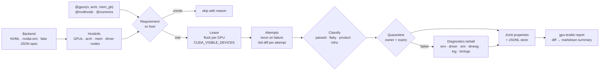

# gpu-testkit

> Part of [inference-qa-lab](../README.md). Run every command from `gpu-testkit/`. CI: [`gpu-testkit.yml`](../.github/workflows/gpu-testkit.yml), which runs when this folder changes.

A pytest plugin and diagnostics toolkit for GPU inference test suites. It handles the parts that most GPU teams end up rebuilding on their own. Tests declare the hardware they need and skip with a reason when the host can't provide it. Each test gets exclusive GPUs, even across pytest-xdist workers and concurrent CI jobs. Failures are rerun to find out whether they're flaky, and then labelled product or infra based on evidence such as Xid events in the kernel log. Known-bad tests keep running under a quarantine with an owner and an expiry. Every final failure leaves a diagnostics tarball linked from the JUnit XML. A CLI diffs two runs into a markdown job summary.

The framework is the product here, so it's typed (`mypy --strict`), split into small modules with a public API, and tested from the outside with pytest's `pytester`. That includes real xdist workers competing for fake GPUs.



```python
@pytest.mark.gpus(2, arch=">=sm90", mem_gb=80)
@pytest.mark.numerics("fp8", rtol=1e-5, atol=1e-5)
def test_fp8_gemm(gpu_devices, numerics):          # CUDA_VISIBLE_DEVICES is set to the leased pair
    numerics.assert_close(run_kernel(), reference())
```

## What's covered

Run `make test` for the 120 framework tests. The test named for each property is the one that would fail if the property broke.

| Area | Property | Test |
|---|---|---|
| Markers | `gpus`/`arch`/`mem_gb`/`multinode`/`numerics` skip with a reason naming both the requirement and the host | `test_markers_skip_with_clear_reasons_on_h100`, `test_fp8_skips_on_ampere` |
| Markers | A bad marker (`gpus(0)`, `arch="hopper"`) fails only that test, not the session | `test_invalid_marker_fails_only_that_test` |
| Markers | `mem_gb` is decimal, so an 81559 MiB "80GB" H100 qualifies for `mem_gb=80` | `test_mem_gb_is_decimal_so_80gb_parts_qualify_for_80` |
| Backends | The `nvidia-smi` CSV parser reads both `noheader,nounits` and default output (format fixtures) | `test_smi_parser_reads_*` |
| Backends | The fake backend renders `nvidia-smi` output that round-trips through the real-format parser | `test_fake_renders_what_the_real_parser_reads` |
| Backends | NVML calls map to `HostInfo` (compute capability → sm, bytes → GB, 12060 → CUDA 12.6) | `test_nvml_backend_maps_nvml_calls` (stubbed `pynvml`) |
| Backends | An explicitly requested backend that can't run raises; `auto` never touches real GPUs when a fake spec is set | `test_explicit_backend_never_degrades_silently`, `test_auto_prefers_fake_spec_from_env` |
| Pool | Under 4 real xdist workers, no two concurrently running tests share a GPU | `test_xdist_workers_never_share_a_gpu` |
| Pool | Acquisition is all-or-nothing (no hold-and-wait deadlock) | `test_acquisition_is_all_or_nothing` |
| Pool | A SIGKILLed holder doesn't leak its GPU (kernel releases the `flock`) | `test_dead_holder_does_not_leak_a_gpu` |
| Pool | Timeout errors name the holder, and the failure is classified infra | `test_timeout_names_the_holders`, `test_pool_timeout_is_classified_as_infra` |
| Flakes | Fails then passes → `flaky`; fails every attempt → `product`; reruns keep module fixtures | `test_flaky_and_product_are_told_apart` |
| Flakes | An Xid 79 logged *during* the test → `infra`; Xid 31 (MMU fault) → `product`; an Xid already in the log before the test → not attributed | `test_xid_during_test_makes_failure_infra` |
| Flakes | Registered exception types (and subclasses) → `infra`; `TimeoutError` is not infra by default | `test_infra_from_exception_type_and_custom_ini` |
| Quarantine | Quarantined failures run, don't gate, and are listed under "quarantine is hiding" | `test_quarantined_failure_does_not_gate_but_is_reported` |
| Quarantine | Expired entries gate again; stale entries are reported; entries missing an owner or expiry are rejected | `test_expired_quarantine_gates_again`, `test_rejects_entries_that_would_rot` |
| Diagnostics | A failure writes a tarball and JUnit's `gpu_testkit.diagnostics` property points at it | `test_failure_writes_bundle_and_junit_points_at_it` |
| Diagnostics | Collectors plug in via a hook; a collector that raises is recorded in `manifest.json` and never masks the test failure | `test_custom_collectors_via_hook_and_broken_ones_are_contained` |
| Diagnostics | Secret-looking environment variables are redacted | `test_env_collector_redacts_secrets` |
| Results | JUnit carries devices, GPU model, requirement, host, backend, verdict and attempts | `test_junit_carries_hardware_tags` |
| Results | The JSONL store is identical in-process and under xdist | `test_results_store[in-process]`, `test_results_store[xdist]` |
| Report | Diff buckets: new / still failing / fixed / flaky / infra / quarantine-hidden / release candidates / lost coverage / slower / removed | `test_diff_buckets_every_kind_of_change` |
| Numerics | fp8 e4m3/e5m2 tables match the OCP spec; bf16/fp16 rounding is round-to-nearest-even, with saturation and overflow handled | `test_fp8_tables_match_the_ocp_spec`, `test_quantize` |
| Numerics | Failure message gives worst-element coordinates, ULPs in the target dtype, and an error histogram | `test_failure_message_points_at_the_worst_element` |

## Failure design

| What goes wrong in GPU CI | What gpu-testkit does | Proven by |
|---|---|---|
| Two xdist workers both grab GPU 0 and one OOMs | Exclusive `flock` leases, `CUDA_VISIBLE_DEVICES` set per test | `test_xdist_workers_never_share_a_gpu` |
| A crashed worker holds a GPU forever | The kernel releases locks on exit | `test_dead_holder_does_not_leak_a_gpu` |
| "Retry until green" hides a real regression | Retries classify rather than excuse: a failure that reproduces is `product` unless there's infra evidence | `test_reproducible_failure_without_evidence_is_product` |
| A GPU falls off the bus and the kernel team gets paged | Xid 79/48/74/94/95 logged during the test → `infra`, with the Xid in the evidence | `test_xid_during_test_makes_failure_infra` |
| The quarantine list becomes a graveyard | Owner and expiry are required; expired entries gate again; passing entries are called out for release | `test_expired_quarantine_gates_again` |
| A runner loses GPUs and the suite goes green by skipping | The report has a "Lost coverage" bucket (passed in base, skipped now) | `test_diff_buckets_every_kind_of_change` |
| A red test with no evidence left behind | A diagnostics tarball (env, driver/CUDA, `nvidia-smi`, dmesg tail, Xids during the test, log, timings) linked from JUnit | `test_failure_writes_bundle_and_junit_points_at_it` |
| "Mismatch 0.03" with no location | Worst coordinates, ULP distance, and a histogram of error/tolerance | `test_failure_message_points_at_the_worst_element` |

## The example suite

[`examples/llm_serving_suite`](examples/llm_serving_suite) is what a serving team's suite looks like with the plugin: fp8 GEMM / bf16 softmax / fp16 RMSNorm numerics, TP2/4/8 row-parallel equivalence, a 2-node allreduce, capacity checks gated on `mem_gb`, a team-specific diagnostics collector, a quarantine file, and a flaky NCCL warm-up. The kernels are CPU simulations in [`simkernels.py`](examples/llm_serving_suite/simkernels.py) that reproduce the numerics (fp8 rounding, fp32 accumulation, per-rank bf16 partials). On the fake 8x H100 host, a run gives 11 passed, 1 flaky (passed on rerun), 1 quarantined, and 3 skipped with reasons: Blackwell-only, needs 2 nodes, needs a 140 GB part.

One numerics test is split in two on purpose. Checking an fp8 GEMM directly against fp64 has to allow roughly 12% error, because rounding inputs to e4m3 dominates. Comparing against an fp64 GEMM of the *same fp8-rounded inputs* leaves only accumulation error, so that test uses `rtol=1e-5`. A real kernel bug can hide inside the first tolerance but not the second.

## Run it

```bash
make venv          # .venv with the package (editable) + pytest-xdist, ruff, mypy
make test          # 120 framework tests: unit + pytester end-to-end (~4s)
make lint          # ruff + mypy --strict
make report        # example suite on a fake 8x H100 (-n 4), then diff vs the committed baseline
```

On a real GPU host (`pip install 'gpu-testkit[nvml]'`):

```bash
gpu-testkit hw                                  # what the backend sees
pytest --gpu-backend=nvml --gpu-reruns=2 --gpu-quarantine=quarantine.toml \
       --gpu-results=reports/results.jsonl --junitxml=reports/junit.xml -n 8
gpu-testkit report reports/results.jsonl --base baseline.jsonl --output "$GITHUB_STEP_SUMMARY" --fail-on-new
gpu-testkit pool                                # who holds which GPU right now
gpu-testkit quarantine quarantine.toml --fail-on-expired
```

Options: `--gpu-backend {auto,fake,nvml,smi,none}`, `--gpu-fake-spec` (or `GPU_TESTKIT_FAKE_SPEC`: a preset like `h100x8`/`a100x4`/`l4x1`, inline JSON, or a path), `--gpu-reruns`, `--gpu-quarantine`, `--gpu-results`, `--gpu-run-id`, `--gpu-diagnostics-dir`, `--gpu-no-diagnostics`, `--gpu-lock-dir`, `--gpu-pool-timeout`. Each has an ini equivalent, plus `gpu_infra_exceptions`, `gpu_infra_patterns` and `gpu_xid_watch`.

## CI

- [`ci.yml`](../.github/workflows/gpu-testkit.yml) runs ruff and mypy, then the framework tests on Python 3.12 and 3.13. After that it runs the example suite on a fake 8x H100 with 4 xdist workers, posts the diff against the baseline to the job summary, and uploads JUnit, JSONL and diagnostics bundles.
- [`gpu-selfhosted.yml`](../.github/workflows/gpu-testkit-gpu-selfhosted.yml) is the same flow on `runs-on: [self-hosted, gpu, h100]` with the NVML backend, behind `workflow_dispatch`. **It has never run.** No self-hosted GPU runner is registered for this repo.

## Layout

```
src/gpu_testkit/
  plugin.py        pytest glue: options, markers, fixtures, rerun protocol, JUnit tags, terminal summary
  hardware.py      GpuInfo / HostInfo / ArchSpec / Requirement (pure data + the qualify rule)
  backends/        fake (JSON spec + presets), nvml (pynvml), smi (nvidia-smi parser), null
  pool.py          flock-based exclusive device leases
  classify.py      attempts -> passed / flaky / product / infra
  xid.py           NVRM Xid parser, hardware vs application split
  quarantine.py    TOML quarantine with owner + expiry
  diagnostics.py   collector protocol, built-in collectors, tarball writer
  results.py       JSONL store + report recorder (xdist-safe)
  report.py        run diff + markdown
  numerics.py      quantize (fp32/fp16/bf16/fp8), ULP distance, assert_close
  cli.py           gpu-testkit report | hw | pool | quarantine
tests/             unit tests per module + pytester tests of the plugin; fixtures/ in real tool formats
examples/          a serving-team GPU suite using the plugin, with its baseline run
docs/DESIGN.md     why the protocol, leases, units and quarantine work the way they do
```

## Where this stops

- **No GPU has run any of this.** Every end-to-end run, in CI and locally, uses the fake backend. The NVML backend is tested against a stubbed `pynvml`. The `nvidia-smi` and dmesg/Xid parsers are tested against fixtures I wrote in the real tools' formats, not output captured from real machines. Real `nvidia-smi -q` and `dmesg` collection only happen on a GPU host.
- **The example kernels are CPU simulations.** They reproduce the rounding behaviour of real kernels so the tolerance logic is meaningful, but they say nothing about real kernel performance or correctness.
- **Leases are per host.** They use POSIX `flock` on a local lock dir, which covers xdist workers and concurrent jobs on the same machine. Cross-node scheduling is the job of Slurm or Kubernetes. MIG slices aren't modelled. NVML ignores `CUDA_VISIBLE_DEVICES`, so a test that queries NVML itself sees every device.
- **Xid attribution is by time window.** Any hardware Xid logged while a test ran counts against that test. Concurrent tests on other GPUs can be misattributed: the PCI bus id is parsed but not yet mapped to the leased devices. On many hosts, reading `dmesg` also needs privileges, and without them this signal is simply absent.
- **`--pdb` turns off the custom protocol**, so reruns and classification are off while debugging.
- **`_run_once` uses pytest's private `call_and_report`,** as pytest-rerunfailures does. A pytest major release could break it, and CI will show that on the next run.
