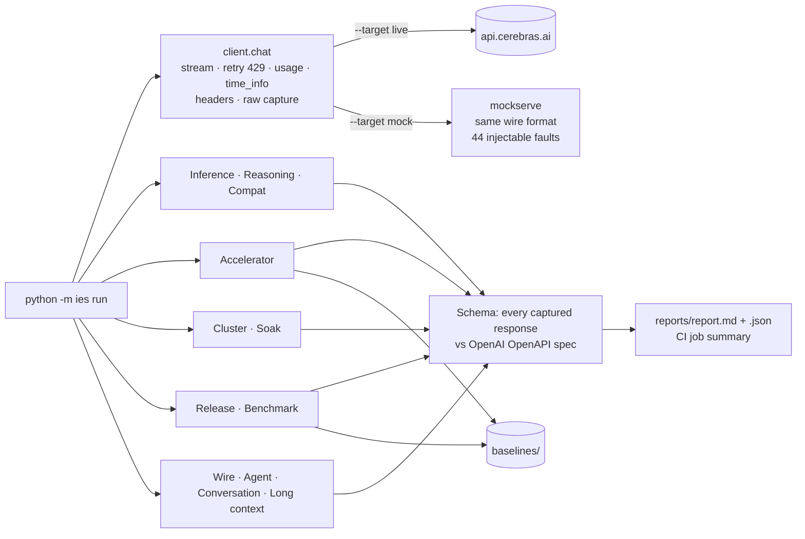

# inference-endpoint-scenarios

> Part of [inference-qa-lab](../README.md). Run every command from `inference-endpoint-scenarios/`. CI: [`inference-endpoint-scenarios.yml`](../.github/workflows/inference-endpoint-scenarios.yml), which runs when this folder changes.

One harness, thirteen scenarios grouped into four areas (Inference, Accelerator, Cluster, Release) plus real-world workloads. It is built for the **Cerebras Inference API** (`api.cerebras.ai`, Chat Completions via `cerebras_cloud_sdk`) and also runs against a wire-compatible local mock with 44 injectable faults. Every check has a fault it must catch, and the tests pin which check catches which fault.

> **Status:** CI runs everything against the mock on every push. The live path is implemented but has not been run yet (no API key configured), so every number in this README comes from the mock, not from Cerebras.

## Scenarios

### Inference: the API contract

| Scenario | What it proves | Example regression it catches |
|---|---|---|
| **Inference** (`inference`) | Usage arithmetic, stream usage, `max_completion_tokens`, stop sequences, strict JSON schema, tool calls (incl. streamed argument reassembly), error codes; **parameter limits** (14 documented boundaries: in-range accepted, out-of-range 400, never a silent 200); **stream integrity** (CJK + emoji intact across chunks, stream = non-stream, a stop sequence spanning two chunks still stops); **logprobs contract** (k entries, sorted, ≤ 0, T=0 choice is top-1) | `total_tokens` ≠ prompt + completion; U+FFFD where an emoji was split; stop sequence matched only within one chunk |
| **Reasoning** (`reasoning`) | `reasoning_effort` none ≤ low ≤ medium ≤ high in reasoning tokens; reasoning stays in `reasoning`, never in content (no `<think>`, no harmony `<\|channel\|>` markers); reasoning tokens billed inside `completion_tokens`; a tight budget ends `length`, not an empty `stop` | reasoning leaks into the answer; effort ignored; empty answer reported as complete |
| **Schema** (`schema`) | Every response and stream chunk the other scenarios produced, validated against the official **OpenAI OpenAPI spec** ([openai/openai-openapi](https://github.com/openai/openai-openapi), pinned commit); Cerebras's additions listed separately (`time_info`, `reasoning`) | `created` as a string; `finish_reason: "eos"`: one off-spec enum value makes the typed SDK fall back to raw dicts for the whole chunk, which breaks three streaming checks too |
| **Compat** (`compat`) | The same requests through the **OpenAI Python SDK** (`base_url=…/v1`, the way the Braintrust and Weave examples call Cerebras) and `cerebras_cloud_sdk`: same usage, `include_usage`, `time_info` via `model_extra`, `max_tokens` honoured like `max_completion_tokens`, tools, strict JSON, `openai.*Error` types | server ignores `max_tokens` (401 tokens back for a limit of 12) |

### Accelerator: hardware effects, as the API shows them

| Scenario | What it proves | Example regression it catches |
|---|---|---|
| **Accelerator** (`accelerator`) | Server decode tok/s (`time_info.completion_time`); prefill rate vs prompt length; TTFT split into queue / prefill / network; prompt cache; T=0 reproducibility and logprob drift; **load invariance** (same T=0 request alone vs inside 7 concurrent requests); **numerics baseline** (logprobs vs the recorded build: same `system_fingerprint` must stay at the noise floor, a new build's drift is reported) | decode 2,000 → 200 tok/s; output changes with batch load (batch-shape-dependent kernels); logprobs move 0.03 with the same fingerprint |

### Cluster: behaviour under load and over time

| Scenario | What it proves | Example regression it catches |
|---|---|---|
| **Cluster** (`cluster`) | Concurrency sweep 1→4→8: latency inflation, errors after retries, 429 absorption, request isolation, rate-limit headroom; **refill**: documented token-bucket limits recover after an idle gap | a request gets another request's answer; limits count a fixed window |
| **Soak** (`soak`, opt-in) | Steady low rate for 5 minutes live (1 rps): errors, p95 per window first vs last, queue_time per window | latency creeping up after a while; error bursts |

### Release: is this build safe to ship

| Scenario | What it proves | Example regression it catches |
|---|---|---|
| **Release** (`release`) | 8 golden cases with exact answers, repeated at T=0, vs baseline + `system_fingerprint` → **GO / NO-GO / INCONCLUSIVE**; **model-list diff** (`/v1/models` vs baseline: removed models are deprecations users will hit as 404s) | arithmetic regression on a new backend build → NO-GO; flaky case → INCONCLUSIVE |
| **Benchmark** (`benchmark`) | 50 fixed GSM8K problems ([openai/grade-school-math](https://github.com/openai/grade-school-math), MIT) vs the baseline with a one-sided two-proportion test and Wilson interval: separates a real drop from noise | 1 wrong → GO (p=0.16); 3 wrong → INCONCLUSIVE (p=0.04); 15 wrong → NO-GO (p<0.001) |
| SDK matrix (CI) | The suite against `cerebras_cloud_sdk` 1.59 / 1.67 / 1.91 + latest | see "SDK matrix: what it found" |

### Workloads: what real applications do

| Scenario | What it proves | Example regression it catches |
|---|---|---|
| **Wire** (`wire`) | msgpack / gzip request bodies reach the server as the same request; bytes saved; TTFT json vs msgpack+gzip | decompression buffer silently truncates the prompt (200 OK, 12,364 vs 5,765 prompt tokens) |
| **Agent** (`agent`) | Two-round parallel tool loop: success, schema-valid arguments, loop latency, tool use | loop never ends; tool results ignored; truncated JSON arguments the model then recovers from |
| **Conversation** (`conversation`) | Turn-1 fact recalled at turn 8; `cached_tokens` grows; turns 2-8 pay prefill for new messages only (~5% uncached) | gateway keeps the last 4 messages; cache never hits (5% → 100%) |
| **Long context** (`longctx`) | Needle recall over length × depth (up to 32K on the mock, 24K live); `prompt_tokens` tracks the haystack; ReadAgent-style gist chain | context silently clipped at ~8K; a summary drops the needed number |



## Run it live

```bash
python3 -m venv .venv && .venv/bin/pip install -r requirements.txt
cp .env.example .env            # put your key in CEREBRAS_API_KEY (cloud.cerebras.ai → API Keys)
.venv/bin/python -m ies chat "Why is fast inference important?"
.venv/bin/python -m ies run --update-baseline    # first run: record release, numerics, model-list, benchmark baselines
.venv/bin/python -m ies run                      # every scenario except soak, a few hundred requests (hard cap 800)
.venv/bin/python -m ies run -w soak              # 5 minutes at 1 rps
.venv/bin/python -m ies run -w accelerator,cluster
```

`chat` is the quickstart done properly: streamed, 429-retried, and printed with usage, cost, and the server's own timing (output format; values illustrative):

```
[USAGE] prompt=15 completion=212 cached=0 cost=$0.000331
[TIME] ttft=… wall=… | server queue=… prefill=… decode=… (… tok/s) fp=…
```

The default model is `qwen-3.8-27b` (300 RPM on the free tier) with `reasoning_effort="none"` except in the Reasoning scenario. `--model gpt-oss-120b` works too, but its free-tier limit is 5 RPM. A hard request budget per run (`max_requests` in `slo.json`) stops a buggy sweep from burning quota. Wire's 12K/16K-token prompts and Long context's haystacks (up to 24K live) dominate token use: ~300K prompt tokens per full run, much of it prompt-cache hits, plus ~50 short benchmark answers. That's under $0.50 at list price even with no cache hits.

## Offline (CI, no key)

```bash
.venv/bin/python -m pytest                                  # 76 tests, ~2 min
.venv/bin/python -m ies run --target mock                   # healthy: every scenario passes
.venv/bin/python -m ies run --target mock --faults slow_decode,crosstalk
```

The mock speaks the real wire format (SSE chunks, final usage + `time_info` chunk, `system_fingerprint`, `x-ratelimit-*` headers, SSE error events, error bodies, msgpack / gzip bodies), so the same client code runs against both. `tests/test_faults.py` pins **which check goes red for which fault**, so a detector can't silently stop working:

| Area | Fault | Caught by |
|---|---|---|
| Inference | `usage_drift` | inference.usage_accounting |
| | `stream_no_usage` | inference.stream_usage_parity, accelerator.decode_throughput |
| | `ignore_max_tokens` | inference.max_tokens_length |
| | `midstream_error` | inference.stream_usage_parity, accelerator.decode_throughput, accelerator.ttft (raises, never truncates silently) |
| | `utf8_split` · `stop_chunk_boundary` | inference.stream_integrity |
| | `logprobs_unsorted` | inference.logprobs_contract |
| | `reasoning_leak` · `harmony_markers` | reasoning.reasoning_separation (+ reasoning_budget: leaked text is billed) |
| | `reasoning_unbilled` · `effort_ignored` · `budget_stop` | reasoning.reasoning_billing · reasoning_effort_scaling · reasoning_budget |
| | `schema_drift` | schema.schema_conformance, plus 3 streaming checks (typed SDK falls back to dicts) |
| | `max_tokens_alias_ignored` | compat.compat_max_tokens |
| Accelerator | `slow_ttft` · `slow_decode` | accelerator.ttft · accelerator.decode_throughput |
| | `nondeterministic` | accelerator.determinism, load_invariance, logprob_baseline |
| | `logprob_noise` | accelerator.logprob_stability, logprob_baseline (argmax unchanged; only numerics see it) |
| | `batch_variant` | accelerator.load_invariance |
| | `numerics_shift` | accelerator.logprob_baseline (fail on the same build; warn with `fingerprint_v2`) |
| Cluster | `contention` · `crosstalk` | cluster.concurrency_latency · cluster.request_isolation |
| | `rate_limit_light` | nothing: retries absorb it (asserted) |
| | `rate_limit_storm` | cluster.error_rate, cluster.retry_absorption |
| | `fixed_window` | cluster.rate_limit_refill |
| | `latency_creep` · `error_burst` | soak.soak_latency_creep · soak.soak_errors |
| Release | `regress_math` + `fingerprint_v2` | release → **NO-GO**, names the cases and the fingerprint change |
| | `flaky_answers` | release → **INCONCLUSIVE** |
| | `fingerprint_v2` alone | release → GO with a warning |
| | `model_removed` | release.models_diff → deprecation warning |
| | `benchmark_noise` · `benchmark_drift` · `benchmark_regression` | benchmark → GO · INCONCLUSIVE · NO-GO |
| Workloads | `gzip_ignored` · `msgpack_as_json` | wire.wire_equivalence, wire.wire_ttft (400) |
| | `decompress_truncation` | wire.wire_equivalence (200 OK; only a cross-encoding comparison sees it) |
| | `bad_tool_args` · `agent_loop_stall` · `ignore_tool_results` | agent.agent_tool_args · task_success + loop_latency · task_success |
| | `history_truncated` · `cache_miss` | conversation.conversation_recall · cache_growth + prefill_flat |
| | `context_truncated` · `lossy_gist` | longctx.needle_recall + context_accounting · longctx.gist_chain |

## CI

`.github/workflows/inference-endpoint-scenarios.yml`:
- **mock** (every push / PR): tests, then the full harness healthy, then a fault run that must fail.
- **sdk-matrix** (every push / PR): the full suite against `cerebras_cloud_sdk` 1.59.0, 1.67.0, 1.91.0, and the latest PyPI release (canary, doesn't block).
- **live** (nightly + manual dispatch): every scenario including soak against `api.cerebras.ai` using the `CEREBRAS_API_KEY` repo secret; report in the job summary. Skips cleanly if the secret isn't set.

## SDK matrix: what it found

| SDK | Result |
|---|---|
| 1.35.0 | no `reasoning_effort` parameter; no `delta.reasoning` |
| 1.50.1 | `usage.completion_tokens_details` comes back as a plain dict, so `.reasoning_tokens` raises `AttributeError` |
| 1.59.0, 1.67.0 | pass, once `prompt_cache_key` goes through `extra_body` (the typed parameter only exists in newer SDKs) |
| 1.91.0 | pass |

So the harness declares a minimum (`MIN_SDK = 1.59.0` in `ies/client.py`), refuses older SDKs with an upgrade message, and sends newer API parameters through `extra_body`.

## Sources

From [cerebras/inference-examples](https://github.com/cerebras/inference-examples): Wire ([payload-compression](https://github.com/cerebras/inference-examples/tree/main/payload-compression)), Agent (the LangChain / LlamaIndex agent workflows), Compat (the Braintrust and Weave examples, which use the OpenAI client), Conversation ([conversational-memory-langchain](https://github.com/cerebras/inference-examples/tree/main/conversational-memory-langchain)), Long context ([gist / ReadAgent](https://github.com/cerebras/inference-examples/tree/main/gist)). SDK matrix: [cerebras/cerebras-cloud-sdk-python](https://github.com/cerebras/cerebras-cloud-sdk-python).

From OpenAI: Schema ([openai/openai-openapi](https://github.com/openai/openai-openapi)), Benchmark ([openai/grade-school-math](https://github.com/openai/grade-school-math)), Reasoning's control-marker list ([openai/harmony](https://github.com/openai/harmony), the response format of gpt-oss, which Cerebras serves). Both external sources are vendored at a pinned commit by `scripts/vendor_sources.py` (17 of the spec's 2,272 schemas; a seeded 50-item GSM8K slice).

## Related repos

This repo sees the platform and hardware only through the API. The other side of the API, all simulated:
[inference-platform-qa](../inference-platform-qa) (Kubernetes deployment path: ingress, load balancing, rolling deploys) ·
[sampling-precision-validation](../sampling-precision-validation) (token sampler and low-precision accuracy) ·
[gpu-cluster-bringup](../gpu-cluster-bringup) (bring-up and burn-in) ·
[gpu-fabric-validation](../gpu-fabric-validation) (collectives and interconnect) ·
[gpu-fault-rca](../gpu-fault-rca) (fault injection and root cause) ·
[gpu-testkit](../gpu-testkit) ·
[inference-release-integration](../inference-release-integration) (compiler / runtime / kernel release qualification) ·
[llm-serving-validation](../llm-serving-validation) (serving-engine internals).

## Where this stops

- "Accelerator" means hardware effects **as observed through the API** (server timing, numerics, load invariance), not on-device kernel or firmware testing.
- Load is small by design: ≤ 8 concurrent, soak at 1 rps. It measures the shape of the curves, not capacity limits.
- Live thresholds in `slo.json` are provisional until calibrated from repeated live runs. Seed determinism, load invariance, prompt caching and rate-limit refill are reported, not gated, on live: the API documents seed and caching as best-effort, and rate-limit header names aren't documented.
- The golden suite and the GSM8K slice are release gates ("did this build get worse than the last qualified one"), not model evaluations.
- The mock simulates uplink bandwidth (4 MB/s) so compression shows a TTFT effect offline; live, it's reported, not gated.
- Not covered: RAG demos (need Pinecone / Weaviate), LLM-as-judge evals (non-deterministic gate), Streamlit UIs, human-eval (executes model-written code), CSL kernels ([cerebras/sdk-examples](https://github.com/cerebras/sdk-examples): need the Cerebras SDK).

See [docs/STRATEGY.md](docs/STRATEGY.md) for why each signal gates or doesn't.
