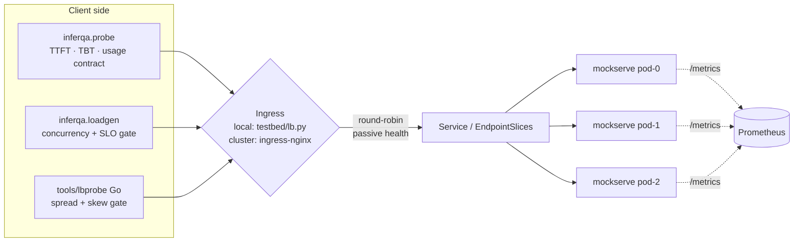

# inference-platform-qa

> Part of [inference-qa-lab](../README.md). Run every command from `inference-platform-qa/`. CI: [`inference-platform-qa.yml`](../.github/workflows/inference-platform-qa.yml), which runs when this folder changes.

A test harness for the **deployment path** of an OpenAI-compatible inference service: client → ingress (NGINX) → Service → pods.
It doesn't test the model. It tests the platform around it: streaming through proxies, load balancing, service discovery, readiness, rolling deploys, and failover.
Those are the parts that break when you run inference at scale, and the model team usually isn't the first to see them.

The same assertions run on two layers:

- **Local testbed**: no Docker. Three real replica processes sit behind a proxy that copies NGINX upstream behaviour. Runs in about 15 seconds.
- **Cluster**: kind with real ingress-nginx and the production manifests. The cluster tests take `INGRESS_URL`, so they can be pointed at EKS or staging; so far they have only run on kind in CI.



## What's covered

| Layer | Property | Test |
|---|---|---|
| API contract | SSE framing: role chunk, finish chunk, usage chunk with `choices: []`, `[DONE]` | `test_stream_wire_format` |
| API contract | `usage.completion_tokens` matches the chunks actually streamed (a billing-gap check) | `test_sdk_stream_and_usage_agree` |
| API contract | `finish_reason=length` gets flagged, a missing usage chunk gets flagged, 404/400 errors map to the correct SDK exception | `test_contract.py` |
| Retry | 429s are retried with jittered backoff and `MAX_ATTEMPTS` is honoured (counted on the server) | `test_429_retried_then_raised` |
| Load balancing | Even round-robin spread across replicas | `test_round_robin_spreads_evenly`, `lbprobe -max-skew` |
| Streaming | The proxy doesn't buffer SSE, so TTFT stays well below total time | `test_sse_is_not_buffered`, `test_ingress_does_not_buffer_sse` |
| Failover | A killed pod gets no traffic, and connection-refused errors never reach the client | `test_killed_replica_gets_no_traffic` |
| Failover | An ejected peer comes back after `fail_timeout` | `test_ejected_replica_returns_after_fail_timeout` |
| Safety | A POST that reached a pod is **not** replayed after the pod dies mid-stream, so nothing is billed twice | `test_midstream_failure_is_not_replayed` |
| Lifecycle | SIGTERM: readiness drops to 503, the in-flight stream finishes, and the process exits 0 | `test_sigterm_drains_inflight_stream` |
| Lifecycle | Traffic that arrives after SIGTERM (endpoint lag) is still served, not refused | `test_late_traffic_during_drain_grace_is_served`, `test_rolling_replace_behind_proxy_is_zero_error` |
| Lifecycle | Not-ready ≠ not-live: a pod leaves rotation but isn't restarted | `test_not_ready_replica_refuses_admin_toggle` |
| Discovery (k8s) | EndpointSlices match exactly the Ready pods | `test_endpoints_match_ready_pods` |
| Discovery (k8s) | A pod that fails `/readyz` leaves the EndpointSlices and stops receiving traffic | `test_not_ready_pod_leaves_rotation` |
| Chaos (k8s) | SIGKILL one pod under load and stay within a 2% error budget | `test_pod_kill_under_load_stays_within_error_budget` |
| Release (k8s) | `rollout restart` under load with **zero** failed requests | `test_rolling_restart_is_zero_error` |
| Performance | p50/p99 TTFT, TBT, output tok/s, error rate, and replica count are gated by `slo/default.json` | `test_load_meets_slo`, `inferqa.loadgen` |
| Latency attribution | W3C `traceparent` crosses client → lb → pod; every hop records spans; client TTFT splits into per-hop time that sums exactly | `test_trace_context_propagates_through_proxy`, `test_hops_are_non_negative_and_explain_ttft` |
| Latency attribution | A ~350ms TTFT regression is traced to the server's batch scheduler (≥90% of the delta), not the network or lb | `test_350ms_gap_is_attributed_to_the_scheduler` |
| Latency attribution | Per-hop p99 budgets (`slo/latency_budget.json`) fail the regression on `sched_wait` and pass the fix; the fix still batches bursts | `test_budget_gate_fails_regression_and_passes_fix`, `test_adaptive_fix_still_batches_bursts` |

## Failure design

Common failure modes in production inference stacks, and the config that prevents each one:

| What goes wrong | Prevention | Proven by |
|---|---|---|
| The UI freezes and then dumps the whole answer at once | `proxy-buffering: off` + `X-Accel-Buffering: no` | SSE buffering tests |
| Long generations get cut at 60s | `proxy-read-timeout: 300` | ingress annotation (review in PR) |
| A rolling deploy drops streams | `maxUnavailable: 0`, `preStop` sleep, SIGTERM drain in the server | `test_rolling_restart_is_zero_error`, `test_sigterm_drains_inflight_stream` |
| Traffic still reaches a pod after SIGTERM (Endpoints removal is async) | `preStop` 5s, then the server keeps accepting for 10s more while readiness fails, then closes its listener so late requests get connection-refused, which NGINX retries safely. `mockserve_served_while_draining_total` measures the lag | `test_late_traffic_during_drain_grace_is_served`, CI run 43620047560 (2/300 503s before the fix) |
| A retry storm double-bills customers | `proxy-next-upstream: error timeout` only, with no `non_idempotent` | `test_midstream_failure_is_not_replayed` |
| A node drain takes out capacity | PDB `minAvailable: 2` + topology spread | manifests |
| TTFT jumps 350ms and nobody can say where | Per-hop spans + `inferqa.latency` decomposition and baseline diff; per-hop budgets name the owning team. The seeded cause: a fixed 350ms batch window that never fills at real concurrency. The fix: dispatch when arrivals go idle | `test_350ms_gap_is_attributed_to_the_scheduler`, `scripts/latency_demo.py` in CI |
| A failed CI run with no clues | `scripts/collect_diagnostics.sh` dumps pods, EndpointSlices, ingress logs, and events as artifacts | CI `if: failure()` |

## Latency attribution: tracing a 350ms TTFT gap

End-to-end TTFT tells you a request is slow, but not where the time went. Every request carries a W3C `traceparent`. The lb and the pod each record spans, and `inferqa.latency` splits client TTFT into hops that sum exactly to the total:

```
client_network = client TTFT  − lb.ttfb       lb           = lb.ttfb − server.ttfb
sched_wait     = server.sched_wait            prefill      = server.prefill
server_other   = server.ttfb − sched_wait − prefill
```

The seeded regression is a scheduler change that adds a fixed 350ms batch window to improve batch fill. At 4-way concurrency the batch never fills, so every request waits the whole window (`scripts/latency_demo.py`, local run):

| Scheduler | TTFT p50 | sched_wait p50 | Budget | Owner of Δ |
|---|---|---|---|---|
| `immediate` (baseline) | 28.6 ms | 0.0 ms | ✅ | |
| `fixed-wait` (regression) | 386.9 ms | 354.0 ms | ❌ sched_wait p99 355 ms > 50 ms | **sched_wait, 99% of +358 ms** |
| `adaptive` (fix) | 35.5 ms | 6.2 ms | ✅ | |

The fix dispatches as soon as arrivals go quiet (5ms idle gap), so a lone request isn't held back while bursts still form batches (`test_adaptive_fix_still_batches_bursts`). CI reruns the demo and posts the table to the job summary.

On a real cluster, the same split comes from the ingress-nginx access log (`$upstream_connect_time`, `$upstream_header_time`, `$request_time`) or its OpenTelemetry module, plus the serving engine's own spans.

## Run it

```bash
make venv && make test          # 62 tests: unit + local-testbed integration (~30s)
make go                         # Go lbprobe vet + tests
make smoke                      # testbed up → probe → Go spread gate → load + SLO gate
.venv/bin/python scripts/latency_demo.py   # baseline → 350ms regression → fix, per-hop table
make kind && make cluster-test  # needs docker, kind, kubectl
```

The same probe works against a real endpoint:

```bash
CEREBRAS_API_KEY=... python -m inferqa.probe --base-url https://api.cerebras.ai/v1 --model qwen-3.8-27b "hello"
```

## Layout

```
mockserve/        OpenAI-compatible replica: SSE, usage chunk, probes, /metrics, SIGTERM drain, fault injection
testbed/lb.py     L7 proxy that copies NGINX upstream semantics (RR, max_fails/fail_timeout, next_upstream)
inferqa/          probe (one stream + contract checks), loadgen (concurrency + SLO gate), metrics (pure math)
tools/lbprobe/    Go load-spread probe: replica skew, status mix, p50/p99; exit 1 gates a stage
tests/            unit/ · integration/ (local testbed) · cluster/ (kind in CI; any cluster via INGRESS_URL)
deploy/           kustomize base + kind overlay, kind config, ArgoCD Application
.github/ Jenkinsfile   same pipeline in both: testbed → smoke → kind cluster → diagnostics on failure
docs/TEST_PLAN.md release validation strategy
```

## Where this stops

- Span timestamps use wall-clock time. On one host that is exact enough. Across hosts, hop math is only as good as clock sync (PTP or NTP), which is why real tracing systems record durations within each process and only stitch hops together by parent and child span.
- The mock replica covers **platform** behaviour only. It says nothing about model quality, KV-cache pressure, or hardware-specific latency. On real hardware, swap the image and tighten `slo/` per model.
- `testbed/lb.py` copies only the NGINX behaviour the tests assert on. Anything that depends on real ingress behaviour has a `cluster` test.
- The cluster tests run in the CI kind job. They need Docker, kind, and kubectl, and they're skipped locally when `kubectl` is missing.
